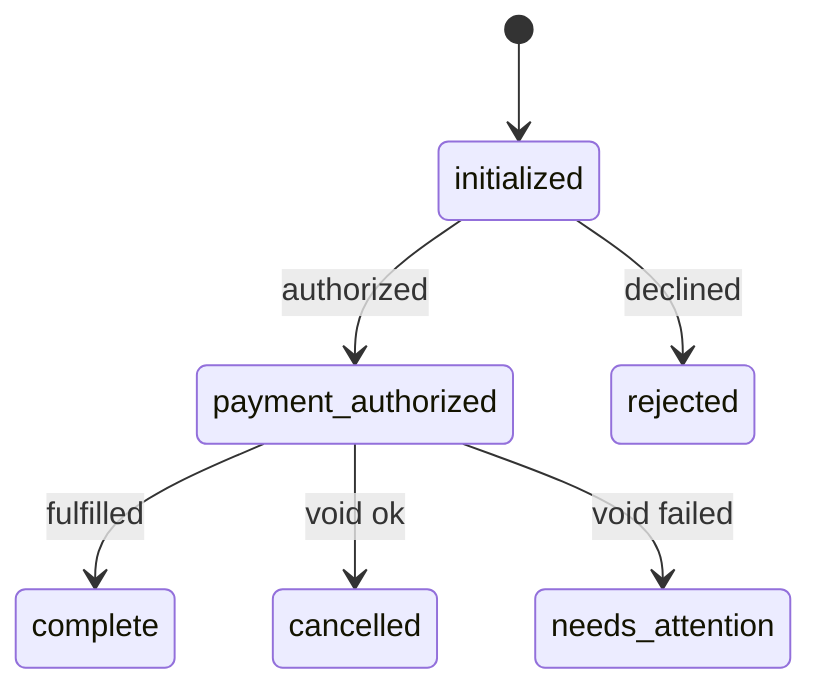

# Order State Machine

A small checkout service that models an order's lifecycle as a state machine, with failure recovery that depends on where the failure happened.

```
initialized -> payment_authorized -> complete
```

## What I built and why

The problem is that "something failed" means different things at different stages:

| What failed | Recovery | Final state |
|---|---|---|
| Payment declined | Nothing was held, so no cleanup | `rejected` |
| Completion failed, void succeeded | Release the payment hold | `cancelled` |
| Completion failed, void failed | Nothing more automation can do; surface it for a human | `needs_attention` |

The service is a minimal orchestrated saga. Authorizing payment is a step, voiding the authorization is its compensating action, and a transition table guards which moves are legal. `needs_attention` plays the role of a dead-letter state: it parks the case that automation can't resolve, and it keeps the evidence.

### State diagram



`complete`, `rejected`, `cancelled`, and `needs_attention` are terminal. The service never moves an order out of them.

### Key design decisions

- **The transition table is data.** `domain/transitions.ts` lists, for every state, which states may come next. The whole state machine can be read in about ten lines, and the compiler forces an entry for every state.
- **The table says what is legal; the service decides what to do.** `OrderService` is the only place that knows "completion failed, so void, then cancel, or escalate if the void fails." Every move still passes through the table, so a bug in the policy can't put an order in an impossible state.
- **The legality check runs before any side effect.** Authorizing twice returns a 409 without calling the gateway a second time, so a customer is never double-held.
- **A partial failure is its own state, not a flavor of `cancelled`.** If the void fails, the order goes to `needs_attention`, and the void error is stored in three places: `failure.voidError`, the final history entry, and a `console.error`. Dashboards and queries can't mistake it for a clean outcome.
- **A decline is a return value; a gateway failure is an exception.** A declined card is a routine business outcome. A timeout or outage is a different kind of event, and the interface keeps them apart.
- **Payment, fulfillment, and storage are interfaces** with a stub or in-memory implementation each. Swapping in a real provider or Postgres is a change to `src/index.ts` only.
- **Clients choose actions, never states.** The API has `authorize` and `complete`, not "set state to X."
- **Money is integer cents.** No floating-point rounding bugs.

## API

| Method and path | Purpose | Success |
|---|---|---|
| `POST /orders` | Create an order. Body: `{ "amountCents": 2500, "currency": "usd" }` | `201` |
| `POST /orders/:id/authorize` | Authorize payment (`initialized` to `payment_authorized` or `rejected`) | `200` |
| `POST /orders/:id/complete` | Complete the order (`payment_authorized` to `complete`, `cancelled`, or `needs_attention`) | `200` |
| `GET /orders/:id` | Current state, failure details, and full history | `200` |

**Status codes**

- A declined payment or a failed completion returns **200** with the outcome in the body (`state: "rejected"`, `"cancelled"`, or `"needs_attention"`). The request did what was asked, and the step had a business outcome. A 4xx would mean the client erred, and a 5xx would mean the server broke. Neither is true.
- `400`: invalid body or malformed JSON
- `404`: unknown order id
- `409`: the order's current state doesn't allow this action (the body includes `from` and `to`)
- `500`: unexpected error; details are logged, not returned

### The order document

```json
{
  "id": "b7e1c9a4-3f52-4d0e-9a17-5c2e8f6d1b30",
  "state": "needs_attention",
  "amountCents": 2500,
  "currency": "USD",
  "paymentAuthorizationId": "auth_1",
  "failure": {
    "stage": "completion",
    "message": "ticket delivery failed",
    "voidError": "Void failed for auth_1"
  },
  "history": [
    { "from": null, "to": "initialized", "at": "...", "reason": "order created" },
    { "from": "initialized", "to": "payment_authorized", "at": "...", "reason": "payment authorized" },
    { "from": "payment_authorized", "to": "needs_attention", "at": "...", "reason": "completion failed: ticket delivery failed; void failed: Void failed for auth_1" }
  ],
  "createdAt": "...",
  "updatedAt": "..."
}
```

`failure.voidError` is present only when the void also failed. That is what marks a partial failure.

## How to run it

Requires Node 20 or newer.

```bash
npm install
cp .env.example .env
npm start
```

| Script | What it does |
|---|---|
| `npm start` | Run the server (default port 3000) |
| `npm run dev` | Run with file watching. Restarts wipe in-memory orders, so use `npm start` for manual scenario runs |
| `npm test` | Run the test suite |
| `npm run typecheck` | Type-check with `tsc` |
| `npm run lint` / `npm run lint:fix` | ESLint (formatting is handled by `@stylistic/eslint-plugin`, no Prettier) |

### Trying each scenario

Payment and fulfillment are stubs, and their behavior is controlled by environment variables. Variables set in the shell override `.env`.

| Scenario | Start the server with |
|---|---|
| Happy path | `npm start` |
| Payment decline | `STUB_AUTHORIZE=decline npm start` |
| Completion fails, void succeeds | `STUB_FULFILL=fail npm start` |
| Completion fails, void fails | `STUB_FULFILL=fail STUB_VOID=fail npm start` |

`STUB_VOID=fail` only matters when `STUB_FULFILL=fail` is also set, because a void is only attempted after a completion failure.

With the server running, in another terminal:

```bash
ID=$(curl -s -X POST localhost:3000/orders \
  -H "content-type: application/json" \
  -d '{"amountCents": 2500, "currency": "usd"}' | jq -r .id)

curl -s -X POST localhost:3000/orders/$ID/authorize | jq .state
curl -s -X POST localhost:3000/orders/$ID/complete | jq '{state, failure}'
curl -s localhost:3000/orders/$ID | jq -r '.history[] | "\(.from // "start") -> \(.to)  (\(.reason))"'
```

(`jq` is optional; it only pretty-prints.)

## Project structure

```
src/
  index.ts          entry point: wires dependencies, calls listen()
  config.ts         env parsing (zod)
  domain/           states, transition table, typed errors. No dependencies
  payments/         PaymentGateway interface + configurable stub
  fulfillment/      OrderFulfillment interface + configurable stub
  repository/       OrderRepository interface + in-memory implementation
  services/         OrderService: the lifecycle and the failure-recovery policy
  api/              Express app factory, routes, request schemas, error mapping
tests/              mirrors src/
  helpers/          shared test app builder
```

## Testing

```bash
npm test
```

The four required scenarios are covered at two layers:

- `tests/services/order-service.test.ts` proves the recovery logic: which calls were made, what was stored, and what history was recorded.
- `tests/api/routes.test.ts` proves the wiring over HTTP: status codes and response bodies.

| Scenario | Asserts |
|---|---|
| Happy path | Three history entries in order, no failure recorded, no void attempted |
| Payment decline | `rejected`, decline reason recorded, no void, no fulfillment |
| Completion failure, void succeeds | `cancelled`, the exact authorization id was voided, no `voidError` |
| Completion failure, void fails | `needs_attention` (not `cancelled`), both errors recorded, void attempted once, error logged |

Also covered: every legal and illegal transition, terminal states, invalid calls producing no side effects, validation, 404, 409, and a 500 that doesn't leak internals.

Test titles state what is tested, the condition, and the expected result, so a failing test's name alone says what broke. The stubs record their calls, so tests can prove the right recovery path ran instead of only checking final states.

## Assumptions and tradeoffs

- **Completion is a stubbed `OrderFulfillment` interface.** The prompt doesn't say what completion does, and modeling it like payment is the only way to produce a completion failure on demand.
- **A gateway error during authorize is treated as a rejection (fail closed).** This is simple and safe for the customer, but a real timeout is ambiguous: the hold may have been placed. Production needs idempotency keys and reconciliation.
- **Storage is in memory.** Orders are lost on restart, including `needs_attention` ones. Fine for a prototype, and the biggest gap for production.
- **`needs_attention` is terminal.** There is no resolve action.
- **No void retry.** One failed void escalates immediately. A real system would retry transient failures first.
- **No concurrency protection.** Two simultaneous requests on the same order could both pass the transition check.
- **The process is the saga.** If it dies between a failed completion and the void, the order is left `payment_authorized` with a live hold.
- **Out of scope:** auth, ticket and event details, pagination, structured logging, metrics.

## What I'd do with more time

In rough order of impact:

1. **Durable storage.** A `PostgresOrderRepository` behind the existing interface, so `needs_attention` orders survive a crash.
2. **Crash safety for compensation.** Persist a `voiding` state before calling the gateway, plus a reconciliation job that sweeps stale `payment_authorized` orders. A crash mid-compensation then can't leave a hold behind.
3. **Retries and idempotency.** Retry void with backoff before escalating, and send idempotency keys on authorize and void so retries are safe and ambiguous timeouts are recoverable.
4. **Optimistic locking.** A `version` column checked on save, so concurrent requests can't both win.
5. **Closing the loop on `needs_attention`.** A resolve endpoint, `GET /orders?state=needs_attention` for a support queue, and alerting on it.
6. **A durable-execution engine.** Run the same saga on Temporal or Cloud Workflows. Activity retries replace the retry-before-escalate step, exhausted retries land in the same `needs_attention` state, and workflow progress survives restarts. Emit order events through an outbox so state changes and events can't diverge.
7. **Operational basics.** Authentication, structured logging with order ids, and metrics on state counts and void failures.